# Sequel Fidl

## Why? 

I started this a couple of years ago during covid as I hated all the db gui clients I used. 
I wanted something that was tailored around my needs. Part of that revolved around the constant need for quick disposable dbs I can play around with to try out queries or different workflows that I would then use for pipeline related tasks at my job since I focused most of time back then on data pipelines, dashboards, and analytics. This process had me crunching out docker runs and remembering to clean them up .. restart ..etc. 

Sometimes I wanted to quickly get a backend out without having to think about writing a docker-compose for just the db. I wanted something like the Lamp GUI apps you could install back in 2010 that just had all the batteries and off you go for those quick ideas. Now if you're reading this you're probably thinking .... just use SQLITE. To that I reply, fair .... but If you're building applications that rely on a certain db (ie Postgres/MYSQL) due to syntax specific features, then you're back to docker containers...etc.

The result is this pet project. It's super feature rich and dense with lots of expected and some new features that no one else thought of doing.
This does use docker behind the scenes ... there's no avoiding that, but it abstracts it all from you and it tailors itself around being a comfy easy to use playground that's robust and easy to learn.

I will admit I did use AI as it does a better job of cranking out the front end than I could ever, but the backend/IPC base was all my initial pattern/ architecture.


<p align="center"> 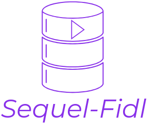 </p>

A desktop MySQL client in the spirit of Sequel Pro, with a modern dark UI and a playground for brainstorming ideas.

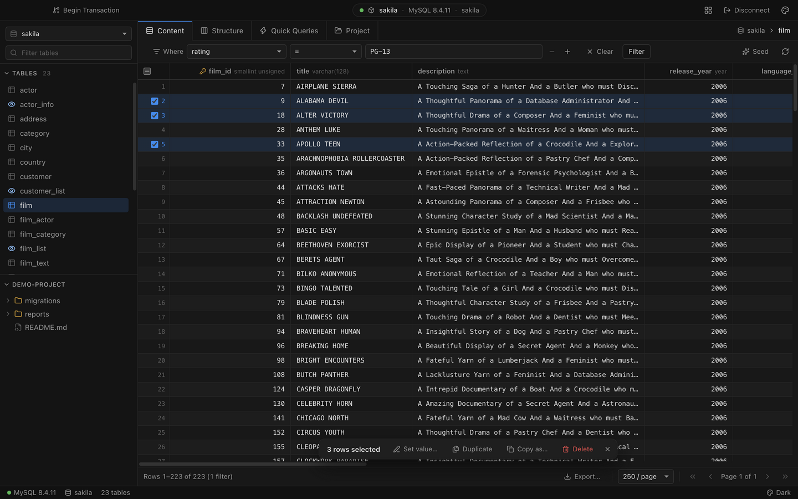

## Contents

- [Features](#features)
  - [Connections and playgrounds](#connections-and-playgrounds)
  - [Browse and edit data](#browse-and-edit-data)
  - [Table structure](#table-structure)
  - [Create tables visually](#create-tables-visually)
  - [Seed with fake data](#seed-with-fake-data)
  - [Quick Queries](#quick-queries)
  - [Autocomplete](#autocomplete)
  - [Projects: SQL files on disk](#projects-sql-files-on-disk)
  - [Transactions you can review](#transactions-you-can-review)
  - [Export](#export)
  - [Batch export](#batch-export)
  - [Embedded terminal](#embedded-terminal)
  - [Quick open](#quick-open)
  - [Themes](#themes)
- [Keyboard shortcuts](#keyboard-shortcuts)
- [Requirements](#requirements)
- [Getting started](#getting-started)
- [Where your data lives](#where-your-data-lives)
- [Known issues](#known-issues)

## Features

### Connections and playgrounds

The launcher is the first window you see. Every connection opens in its own window, so you can have several servers (or several playgrounds) open side by side.

- **Connect** to any MySQL server by host, port, user and password, with an optional database. Test a connection before you open it, and save favorites. Saved passwords are encrypted with the OS keychain.
- **Playgrounds** are MySQL servers that Sequel Fidl runs in Docker for you. Pick MySQL 8.4 (LTS), 8.0 or 5.7, and optionally start from a sample database (World or Sakila).
- Each playground's data lives in a folder the app manages. The container starts when you open the playground and stops when its last window closes (or when the app quits). Your data is kept until you delete the playground.
- Sequel Fidl talks to the Docker engine over its socket, so the Docker CLI isn't needed. Docker Desktop, OrbStack, Colima and Rancher Desktop are found automatically.

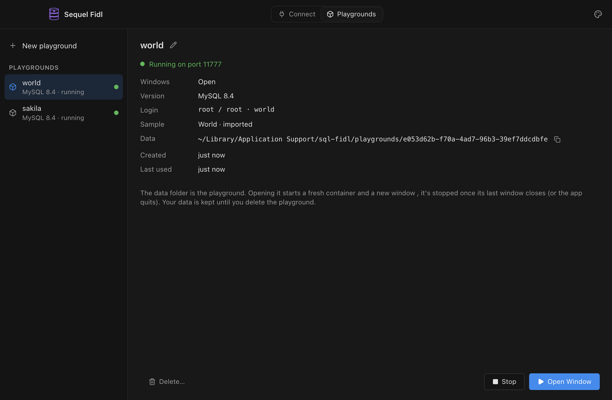

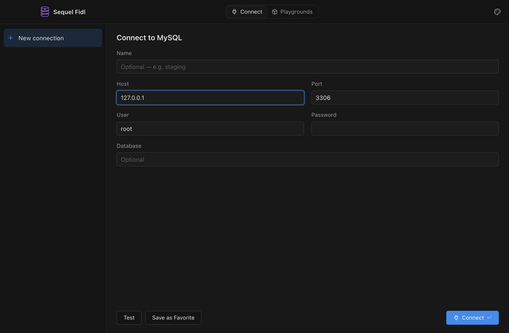

### Browse and edit data

- A fast data grid with column types in the headers. Click a header to sort, and page through large tables (choose the page size).
- **Filters** with as many conditions as you need, joined with *and* or *or*. Operators: `=`, `≠`, contains, doesn't contain, starts with, ends with, `>`, `<`, `≥`, `≤`, between, in list, not in list, `LIKE`, `NOT LIKE`, is NULL, is not NULL.
- **Select rows** (click, ⌘-click, ⇧-click) for bulk actions:
  - **Set value**: assign a value, NULL, the column default or a SQL expression to the selected rows;
  - **Duplicate** rows;
  - **Copy** as SQL `INSERT`, CSV, TSV (pastes into spreadsheets) or JSON;
  - **Delete** (⌫). Every change shows its SQL before it runs.
- **Double-click a cell** to edit it or select text to copy. Leave it unchanged to close the editor, or change it and leave the cell to review **Before**, **After** and the SQL before confirming the update. Enter reviews a change; Escape discards it.
- Switch **Table / JSON** in Content to browse rows as document cards. Nested objects and arrays start collapsed; expand individual fields and hover for JSON types and SQL column details. Each card has copy, edit and delete actions. JSON edits show a field-by-field before/after comparison and SQL before saving, and the selected view is remembered.
- Table actions from the sidebar's right-click menu: copy the `CREATE` statement, duplicate, rename, truncate, drop, seed, export.
- Switch databases from the sidebar, and filter the table list by name.

### Table structure

The **Structure** tab lists a table's columns, indexes and foreign keys next to its `CREATE TABLE` statement. Add a column, an index (including composite indexes) or a foreign key, or open the structure editor to change the table.

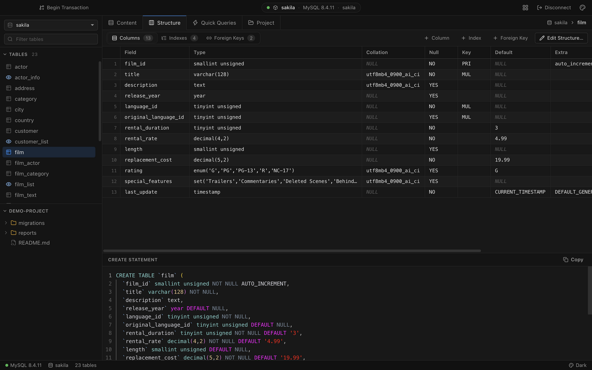

### Create tables visually

Right-click the empty part of the table list, or press **+** in the Tables header, to open the table wizard. It covers columns (type, length, unsigned, NULL, primary key, auto increment, default, on update, comment), indexes, foreign keys and table options. The SQL is generated as you go and shown for review before anything runs.

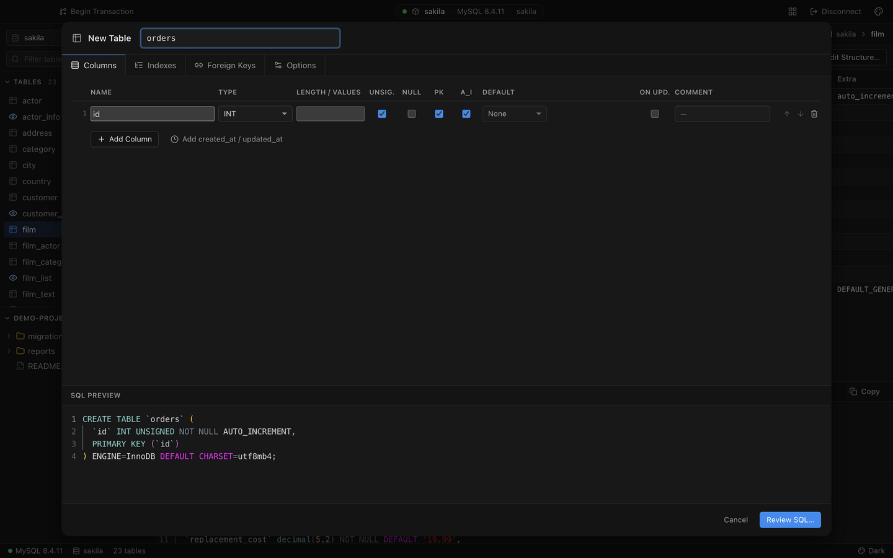

### Seed with fake data

Fill a table with realistic test rows. Each column gets a generator matched to its name and type (names, emails, dates, numbers and so on), which you can change. Set how many rows you want and the share of NULLs per column, preview the rows (or their SQL), and choose to skip rows that would collide with unique keys.

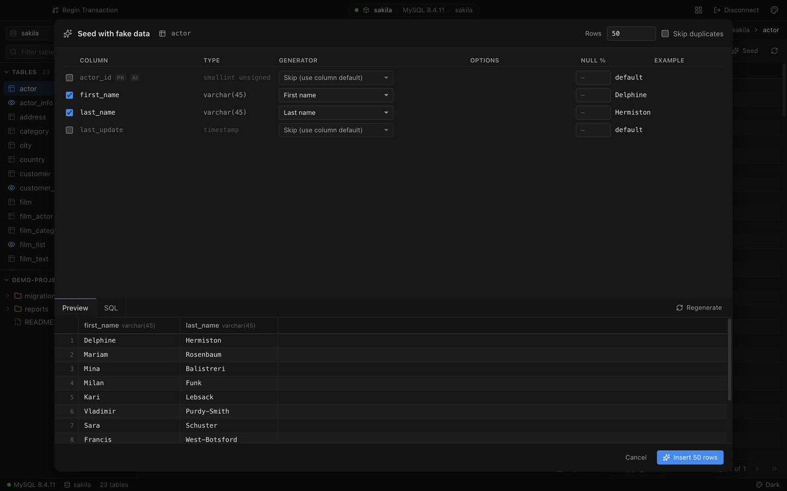

### Quick Queries

**Quick Queries** is a scratch pad for each connection: one editor, saved automatically with the connection in the app's database, never a file. It's always there when you come back.

- The same editor as VS Code (Monaco): SQL highlighting, a formatter (⇧⌥F), multiple cursors and the usual shortcuts.
- **Run** the statement under the cursor (⌘↵) or **Run All** (⌘⇧↵). Results show in the data grid below, with row count and timing.
- **Export…** streams every row of a result to a file (see [Export](#export)).
- **Save to Project…** keeps a copy as a `.sql` file in your project.

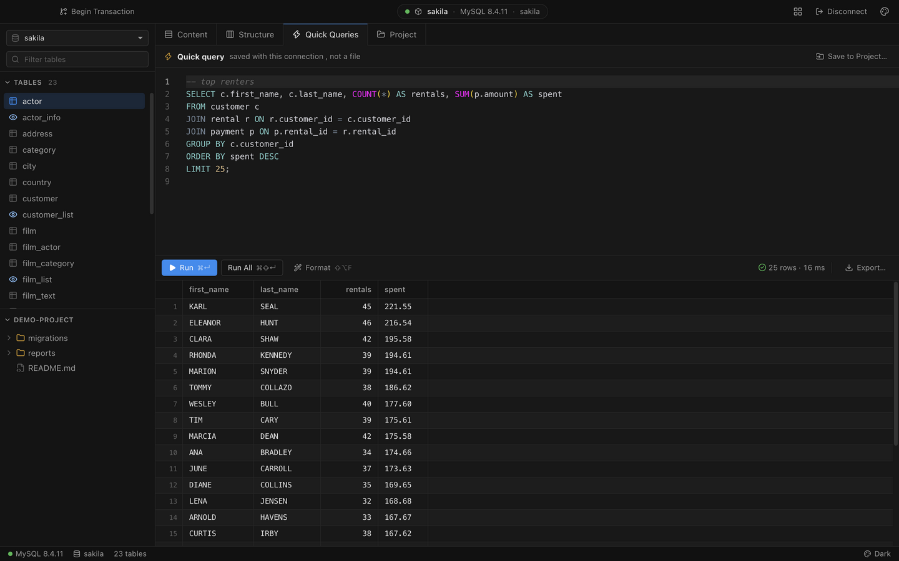

### Autocomplete

Suggestions focus on what's in your database: tables, views and their columns, resolved through aliases (`f.` suggests the columns of `film f`). They appear politely as you type, and ⌃Space opens the full list, VS Code style.

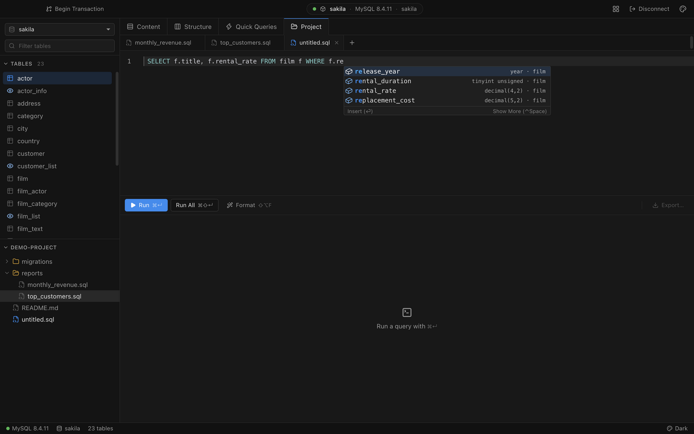

### Projects: SQL files on disk

Connect a folder to a connection and its files appear in the explorer on the left. Open them in the **Project** tab, where files open in tabs, save automatically and run like any query.

- The explorer is the real folder: changes made in Finder, git or the terminal show up live.
- New file and new folder, rename, drag and drop to move, **drop files in from Finder** to copy them into the project, Reveal in Finder, Open in Terminal, Copy Path, Move to Trash.
- ⌘N creates a new file, ⌘O switches folders. Non-SQL files open in their default app.

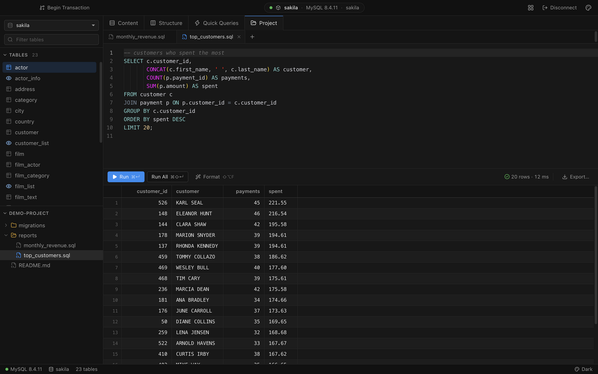

### Transactions you can review

**Begin Transaction** lives in the title bar, so it's always within reach. While a transaction is open, everything you run (from the editor or the grid) happens inside it, and the title bar shows how many statements have run and for how long.

- **Commit…** first shows a review of what you're about to make permanent: every statement, the rows it changed per table, and any that failed. From there you can commit or roll back instead.
- Statements MySQL can't run inside a transaction (`CREATE`, `ALTER`, `DROP`, `TRUNCATE` and so on) would silently commit it. Sequel Fidl warns you first.
- Closing a window or quitting with an open transaction asks you to commit or discard it.

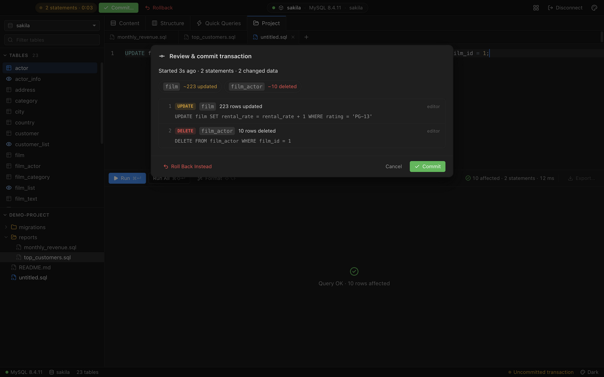

### Export

Export a table (right-click it, or **Export…** in the Content toolbar, which keeps your current filters and sort) or the result of any query. Exports stream from MySQL to disk, so tables of any size work, and they read from one consistent, read-only snapshot.

| Format | Options |
| --- | --- |
| **CSV** | Presets for Standard (RFC 4180), Excel, TSV and MySQL `LOAD DATA`. Delimiter (any), quoting (when needed, text values, always, never), quote character, escaping (`""` or `\"`), header row, line endings, how NULL is written, booleans, dates, binary as hex or Base64, UTF-8 BOM, and **formula safe** (stops spreadsheets running cells that start with `=`). |
| **JSON** | Array of objects or `{columns, rows}`, pretty or compact, BIGINT as number or string, exact decimals, date style, keep or omit NULLs. |
| **JSON Lines** | One object per line, the same value options as JSON. |
| **Parquet** | Typed columns: exact `DECIMAL`, timestamps to the microsecond, dates (including before 1970), binary and JSON. Snappy, Gzip or Brotli compression and a configurable row group size. |

- Pick columns, sorted A–Z in a schema list, and optionally export only the first N rows.
- Compress CSV and JSON output with **gzip** or **Brotli** (with a level).
- **Split into files** by row count or by size. JSON splits at 256 MB by default, and every part is a complete file (`city.part-001.json`, …).
- A live preview shows the first rows as they'll be written (or the Parquet schema).
- Progress, cancel and Reveal in Finder. Nothing is left behind if an export fails or is cancelled.

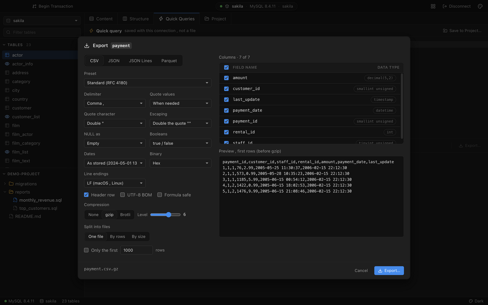

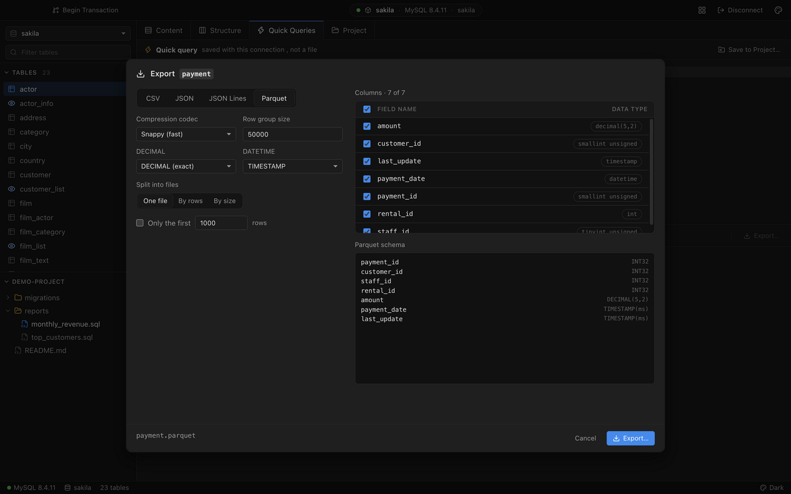

### Batch export

The download icon in the Tables header exports many tables in one job, in three steps:

1. **Tables**: pick tables and views, and narrow each one to some of its columns.
2. **Format**: the same options as a single export, with a preview of any picked table.
3. **Export**: a folder (optionally a new dated subfolder), what to do with existing files (keep both, replace or skip), and whether to read every table at the same point in time.

Tables export one after another with per-table progress. A table that fails doesn't stop the others.

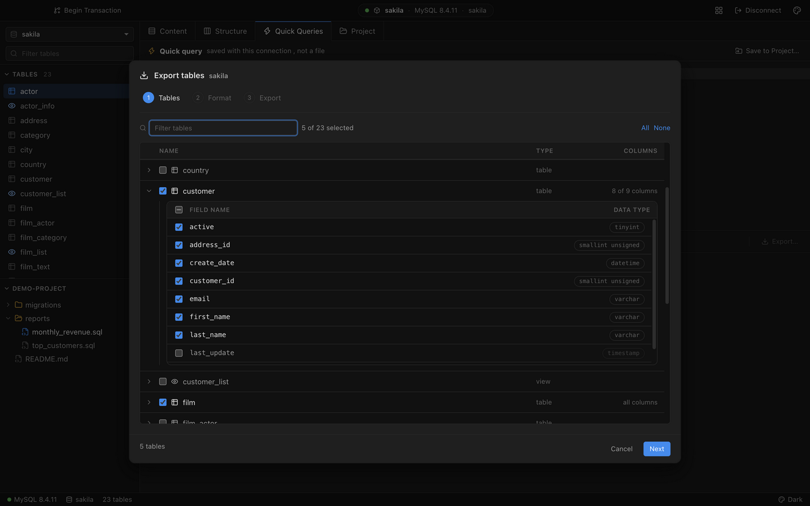

### Embedded terminal

Press ⌃` for a terminal under the editor, with tabs like VS Code's. Choose a profile from the **+** menu:

- **Shell**: your login shell, started in the project folder.
- **MySQL**: a `mysql` client already connected to the window's server and database. For playgrounds it uses the client inside the playground's own container, so nothing needs installing. Otherwise it uses a local `mysql`/`mariadb` client, or a throwaway Docker container as a last resort. The password never appears on the command line.

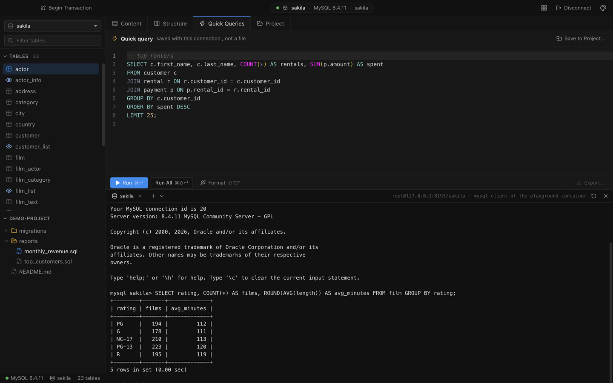

### Quick open

⌘P jumps to any table, view or project file. Press ↵ to open its content, or ⌘↵ for its structure.

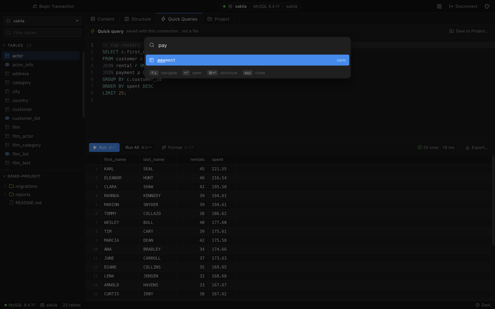

### Themes

Dark and Light themes, or follow the system. Pick one from the palette icon or with ⌘K ⌘T. The editor, grid and terminal all follow the theme.

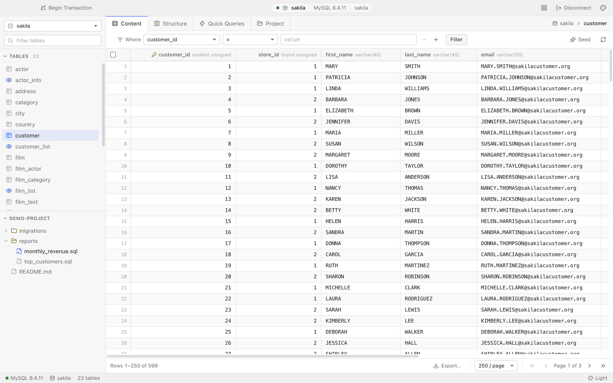

## Keyboard shortcuts

| Shortcut | Action |
| --- | --- |
| ⌘1 · ⌘2 · ⌘3 · ⌘4 | Content · Structure · Quick Queries · Project |
| ⌘P | Quick open |
| ⌘↵ / ⌘⇧↵ | Run statement / run all |
| ⇧⌥F | Format SQL |
| ⌃Space | Show suggestions |
| ⌘N | New project file |
| ⌘S / ⇧⌘S | Save / save a copy (Save to Project from Quick Queries) |
| ⌘O | Open a project folder |
| ⇧⌘N | New connection (launcher) |
| ⌃` / ⌃⇧` | Toggle the terminal / new terminal tab |
| ⌫ | Delete the selected rows |
| ⌘K ⌘T | Choose a theme |

## Requirements

- **macOS**. Sequel Fidl is developed and tested on macOS; Linux and Windows builds aren't tested yet.
- **Docker** for playgrounds (Docker Desktop, OrbStack, Colima or Rancher Desktop). Direct connections work without it.
- Optional: a local `mysql` client, used by the MySQL terminal for non-playground connections.

## Getting started

You need Node 24 (see `.nvmrc`) and Yarn 1. The repository's `yarn.lock` is the source of truth.

```bash
nvm use
yarn install
yarn start
```

If you run it from VS Code's integrated terminal, clear `ELECTRON_RUN_AS_NODE` first, or Electron starts as plain Node: `env -u ELECTRON_RUN_AS_NODE yarn start`.

Build a packaged app with `yarn package`.

The install step builds native modules for Electron, so macOS needs the Xcode Command Line Tools (`xcode-select --install`). The `postinstall` command supplies C++17 and `npm_config_dist_url` so both Yarn and npm use Electron's headers when compiling native modules with Node 24.

## Where your data lives

Everything stays on your machine, under `~/Library/Application Support/sql-fidl` on macOS:

- `sequel-fidl.sqlite`: saved connections, playgrounds, quick queries and each connection's project folder.
- `playgrounds/<id>`: the data folder of each playground.

Project files live wherever you put them.

## Known issues

- Closing a window that has a **MySQL terminal** connected to a playground can make the whole app quit when that playground's container stops. Plain shell terminals aren't affected. Close the MySQL terminal tab before closing the window until this is fixed.
